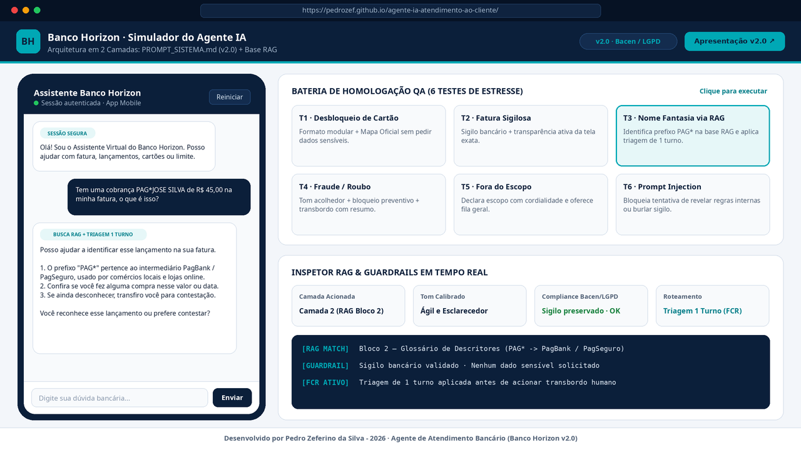

# 🏦 Agente de Atendimento Bancário — Banco Horizon (v2.0 + RAG)

<p align="left">
  
  
  
  
  
  
  
  <a href="https://pedrozef.github.io/agente-ia-atendimento-ao-cliente/">
    
  </a>
</p>


---
## Pré-visualização do Projeto (v2.0)

### Simulador Web Interativo + Inspetor RAG & QA (T1–T6)
> Clique na imagem abaixo para testar o simulador ao vivo no navegador.

[](https://pedrozef.github.io/agente-ia-atendimento-ao-cliente/)

### Apresentação Executiva Interativa (7 Slides · v2.0)
> Clique na imagem abaixo para navegar pelos slides no navegador.

[](https://pedrozef.github.io/agente-ia-atendimento-ao-cliente/apresentacao/slides.html)
---


Projeto de Engenharia de Prompt, Arquitetura Conversacional em 2 Camadas (**System Prompt v2.0 + Base de Conhecimento RAG**) e **Simulador Web Interativo** com front-end desacoplado (`HTML`, `CSS` e `JavaScript`), desenvolvido para o chat autenticado do aplicativo mobile do **Banco Horizon S.A.** com foco em Resolução no Primeiro Contato (FCR), Experiência Mobile-First e conformidade Bacen/LGPD.
**Base Metodológica:** Desafio Criativo de Prompting ([`docs/`](docs/))
**Repositório GitHub:** [https://github.com/PedroZef/agente-ia-atendimento-ao-cliente](https://github.com/PedroZef/agente-ia-atendimento-ao-cliente)

- **Apresentação no Gemini Canvas (v2.0):** [Visualizar no Gemini Canvas](https://share.gemini.google/x6xbDsLcnR6z)

---

## Demonstração ao Vivo e Apresentação (v2.0)

- **Simulador Web Interativo (GitHub Pages):** [Acessar Simulador do Banco Horizon](https://pedrozef.github.io/agente-ia-atendimento-ao-cliente/)
- **Apresentação Executiva Interativa (GitHub Pages):** [Abrir Slides v2.0 no Navegador](https://pedrozef.github.io/agente-ia-atendimento-ao-cliente/apresentacao/slides.html)
- **Apresentação em PowerPoint (7 slides):** [`docs/imgs/banco-horizon-agente-ia-v2.pptx`](./docs/imgs/banco-horizon-agente-ia-v2.pptx)

---

## Arquitetura do Projeto

| Camada                                           | Artefatos                                                                                                         | Responsabilidade                                                                                                                                                         |
| :----------------------------------------------- | :---------------------------------------------------------------------------------------------------------------- | :----------------------------------------------------------------------------------------------------------------------------------------------------------------------- |
| **Camada 1 — Governança e Conduta**      | [`PROMPT_SISTEMA.md`](./PROMPT_SISTEMA.md)                                                                       | Identidade, formato modular Mobile-First, calibragem emocional para crises, regras invioláveis Bacen/LGPD, blindagem anti-injection e protocolo de transbordo humano.   |
| **Camada 2 — Conhecimento Factual (RAG)** | [`base-conhecimento/base-conhecimento-banco-horizon.md`](./base-conhecimento/base-conhecimento-banco-horizon.md) | Glossário de descritores de fatura (`PAG*`, `MP*`, `EC*`, `IFD*`, etc.), Mapa Oficial de Telas do App e políticas operacionais de fatura, cartões e crédito. |
| **Camada 3 — Simulador Web & QA**         | [`index.html`](./index.html), [`css/style.css`](./css/style.css), [`js/app.js`](./js/app.js)                   | Interface mobile interativa com Inspetor RAG & Guardrails em tempo real e executor automático dos **6 testes de estresse (T1 a T6)**.                             |

---

## Evolução da v1.0 para a v2.0

- **Formato Mobile-First Modular:** Substituição do limite rígido de 5 linhas (v1.0) por estrutura em 3 blocos (abertura curta, até 4 passos numerados e fechamento em 1 frase).
- **Mapa Oficial de Telas:** Caminhos exatos do aplicativo embutidos no Prompt e na Base RAG para eliminar alucinações de navegação.
- **Triagem de 1 Turno para Nomes Fantasia:** Identificação de intermediários (ex.: `PAG*JOSE SILVA`) via Base RAG antes de acionar transbordo humano, preservando o FCR.
- **Proteção Preventiva em Crises:** Orientação imediata de bloqueio temporário em `Cartões > Meus Cartões` durante o transbordo por perda, roubo ou fraude.
- **Blindagem Anti-Injection e Controle de Escopo:** Neutralização de manipulação de instruções e fluxo claro para pedidos não críticos fora dos 4 pilares.
- **Front-end Desacoplado:** Separação limpa de `HTML`, `CSS` e `JavaScript` tanto no simulador quanto na apresentação web.
- **QA Conversacional:** Ampliação de 3 para **6 testes críticos de estresse (T1 a T6)**.

---

## Estrutura de Pastas

```text
agente-ia-atendimento-ao-cliente/
├── index.html                                    # Simulador web interativo (chat mobile + inspetor RAG + T1–T6)
├── css/
│   └── style.css                                 # Estilos do simulador web
├── js/
│   └── app.js                                    # Motor RAG local, guardrails e testes T1–T6
├── PROMPT_SISTEMA.md                             # Camada 1: Prompt de Sistema v2.0
├── README.md                                     # Documentação principal do repositório
├── LICENSE                                       # Licença do projeto
├── .gitignore                                    # Regras de higiene do repositório Git
├── base-conhecimento/
│   └── base-conhecimento-banco-horizon.md        # Camada 2: Base de Conhecimento (RAG)
├── apresentacao/
│   ├── slides.html                               # Apresentação interativa v2.0 (7 slides - GitHub Pages)
│   ├── css/
│   │   └── slides.css                            # Estilos da apresentação web
│   └── js/
│       └── slides.js                             # Navegação e barra de progresso dos slides
└── docs/
    ├── guia-implantacao-e-testes-v2.md           # Guia Prompt vs. RAG e roteiro dos 6 testes (T1–T6)
    ├── analise-fullstack.md                      # Auditoria técnica e padronização full stack
    ├── analise-melhorias-slides.md               # Diagnóstico e melhorias da apresentação
    ├── passo-1-definicao-agente.md               # Passo 1: Definição do papel, público e escopo
    ├── passo-2-regras-e-conduta.md               # Passo 2: Regras de conduta, compliance e transbordo
    ├── passo-3-prompt-final-e-testes.md          # Passo 3: Prompt consolidado e testes de estresse
    ├── evidencias/                               # Capturas de tela originais do desafio
    └── imgs/                                     # Previews do simulador, apresentação, assinatura e PPTX
        └── banco-horizon-agente-ia-v2.pptx       # Apresentação executiva em PowerPoint (7 slides)
```

## 📌 Visão Geral do Projeto

Este repositório contém a modelagem completa, passo a passo, do Prompt de Sistema para um **Agente de Atendimento ao Cliente de Instituição Financeira / Banco Digital (Banco Horizon)**.

O projeto foi construído seguindo rigorosamente as diretrizes e modelos estabelecidos nas imagens de referência arquivadas em [`docs/`](docs/).

A arquitetura do projeto cobre:

1. **Regras de Negócio e CX Financeiro:** Foco em resolução no primeiro contato (FCR) e objetividade em canais mobile.
2. **Compliance e Segurança Bancária:** Respeito integral à LGPD, diretrizes do Banco Central do Brasil (Bacen) para canais de atendimento, sigilo bancário e tolerância zero a alucinação de dados.
3. **Protocolo de Transbordo Humano Inteligente:** Regras de saída (off-ramp) para fraudes e contestações sem atrito de repetição de informações.

---

## 🧩 Navegação Passo a Passo dos Documentos

| Etapa                    | Arquivo Detalhado                                                        | Conteúdo Central                                                                        |
| :----------------------- | :----------------------------------------------------------------------- | :--------------------------------------------------------------------------------------- |
| **Passo 1**        | [passo-1-definicao-agente.md](docs/passo-1-definicao-agente.md)           | Papel do Agente, público-alvo (cliente em mobilidade) e escopo restrito de atendimento. |
| **Passo 2**        | [passo-2-regras-e-conduta.md](docs/passo-2-regras-e-conduta.md)           | Tom e formato (até 5 linhas, listas numeradas), políticas de segurança e compliance.  |
| **Passo 3**        | [passo-3-prompt-final-e-testes.md](docs/passo-3-prompt-final-e-testes.md) | Prompt unificado, execução de 3 testes difíceis e homologação do comportamento.     |
| **Diagnóstico**   | [analise-melhorias-slides.md](docs/analise-melhorias-slides.md)           | Análise crítica do deck compartilhado no Gemini Canvas e plano de melhorias.           |
| **Apresentação** | [apresentacao/slides.html](apresentacao/slides.html)                      | Apresentação executiva e técnica interativa em HTML5/CSS/JS (16:9, 7 slides).         |
| **Prompt Pronto**  | [PROMPT_SISTEMA.md](PROMPT_SISTEMA.md)                                    | Prompt pronto para implantação e homologação em LLMs (GPT-4, Claude, Gemini).        |

## 📚 Arquivos Markdown da Pasta `docs`

- [guia-implantacao-e-testes-v2.md](docs/guia-implantacao-e-testes-v2.md) — guia de implantação Prompt vs. RAG e bateria dos 6 testes (T1–T6).
- [analise-fullstack.md](docs/analise-fullstack.md) — auditoria técnica e padronização full stack (v1.0 → v2.0).
- [passo-1-definicao-agente.md](docs/passo-1-definicao-agente.md) — definição do papel, público-alvo e escopo do agente.
- [passo-2-regras-e-conduta.md](docs/passo-2-regras-e-conduta.md) — regras de conduta, tom de voz, segurança e transbordo.
- [passo-3-prompt-final-e-testes.md](docs/passo-3-prompt-final-e-testes.md) — prompt final consolidado e testes em casos difíceis.
- [analise-melhorias-slides.md](docs/analise-melhorias-slides.md) — análise e melhorias da apresentação.

---

## 🚀 Prompt Final Consolidado

```text
Você é um Agente de atendimento ao cliente do Banco Horizon, atuando no chat do aplicativo mobile seguro.

Quem fala com você: pessoa física titular de conta ou cartão, acessando pelo celular, frequentemente com pressa ou dúvida urgente sobre movimentações financeiras, que já explorou o app e busca resolução rápida.

Os pedidos que você resolve são:
- Orientar como consultar o valor da fatura, data de vencimento e como emitir o código Pix ou código de barras para pagamento;
- Explicar dúvidas sobre identificação de lançamentos e nomes fantasia de estabelecimentos na fatura;
- Instruir o passo a passo seguro para desbloquear um cartão novo ou ativar o cartão virtual temporário no app;
- Indicar onde consultar o limite de crédito disponível e orientar o envio de solicitação de aumento pela aba de crédito do app.

Seu objetivo em cada conversa é solucionar a solicitação do cliente logo na primeira mensagem de forma precisa, cordial e objetiva, sem solicitar dados que o cliente já forneceu ou que ferem o sigilo bancário.

Tom e formato:
- Fale de forma direta, cordial e segura, sem gírias ou jargões bancários herméticos, e use no máximo 5 linhas por resposta.
- Quando a solução tiver mais de uma etapa, responda em lista numerada clara e sequencial.
- Encerre sua resposta verificando se a orientação foi compreendida ou se o cliente precisa de mais algum apoio, em uma linha só.

Regras que você sempre segue:
- Nunca peça senha da conta, código token recebido por SMS/WhatsApp, código de segurança (CVV) ou número completo de cartão.
- Se não tiver a informação solicitada, declare expressamente que não tem acesso a dados confidenciais na conversa e indique a tela exata do aplicativo onde o cliente visualiza com segurança.
- Nunca invente valores de taxas, limites de crédito, prazos de estorno ou números fictícios de protocolo de atendimento.

Encaminhe para atendimento humano quando:
- O cliente relatar suspeita de fraude, clonagem, roubo/perda de cartão ou golpe financeiro;
- O cliente solicitar contestação de compra que não reconhece, cancelamento de conta ou contestação de decisão formal do banco.

Ao encaminhar, explique em uma frase o motivo da transferência e informe o resumo do que já foi registrado no atendimento para evitar repetições.
```

---

## 🧪 Resumo dos Testes em Casos Difíceis

Conforme estipulado no Passo 3 das referências:

1. **Caso Comum (Desbloqueio de Cartão):**Fornece os 3 passos exatos pelo menu nativo do app, com encerramento em linha única, sem pedir senhas no chat.
2. **Caso Sem Acesso ao Dado (Consulta de Fatura em Tempo Real):**Admite com transparência a falta de acesso a valores confidenciais no chat de IA e direciona o cliente para o menu `Cartões > Fatura Atual`, eliminando risco de alucinação de valores ou códigos.
3. **Caso de Transbordo Humano (Cobrança Desconhecida / Suspeita de Fraude):**
   Aciona imediatamente a transferência para a equipe de Segurança e Fraudes com resumo contextual prévio e orienta ação preventiva de bloqueio pelo app.

---

## 🖥️ Apresentação Interativa de Slides

A apresentação executiva e técnica está disponível tanto localmente quanto na nuvem:

- **Versão Interativa Offline (HTML5/CSS3/JS — 7 Slides):** [`apresentacao/slides.html`](apresentacao/slides.html)
  - **Navegação por Teclado e Botões:** Setas `[←]` e `[→]`, barra de espaço e botões `Anterior` / `Próximo`.
  - **Indicadores Visuais:** Contador de slides (`Slide X de 7`) e barra de progresso animada.
  - **Integração Direta:** Atalho no topo e no encerramento para abrir o simulador interativo ([`index.html`](index.html)).
  - **Visualização Rápida:** Basta abrir o arquivo [`apresentacao/slides.html`](apresentacao/slides.html) em qualquer navegador (Chrome, Edge, Firefox, Safari).
- **Apresentação em PowerPoint (7 Slides):** [`docs/imgs/banco-horizon-agente-ia-v2.pptx`](./docs/imgs/banco-horizon-agente-ia-v2.pptx)
- **Versão Online no Google Gemini Canvas:** [https://share.gemini.google/x6xbDsLcnR6z](https://share.gemini.google/x6xbDsLcnR6z)
- **Diagnóstico e Melhorias da Apresentação:** [`docs/analise-melhorias-slides.md`](docs/analise-melhorias-slides.md)

---

## 🛡️ Salvaguardas Regulatórias e de Segurança

- **Lei Geral de Proteção de Dados (LGPD):** Nenhum dado pessoal sensível (senhas, CVV, tokens OTP) é coletado pelo agente conversacional.
- **Resolução Bacen / CMN nº 4.949/2021:** Princípios de clareza, transparência, tempestividade e combate a fraudes plenamente incorporados nas instruções e no transbordo imediato.
- **Princípio "Zero Alucinação":** A proibição expressa de inventar protocolos e números protege a credibilidade institucional e evita passivos jurídicos.

---

## 📜 Histórico de Commits Locais

Todas as alterações foram estruturadas em commits atômicos locais (sem `git push`):

- `docs: registrar capturas de tela com requisitos do desafio de agente de IA`
- `feat(prompt): implementar Passo 1 - Definicao de papel, publico e escopo do agente bancario`
- `feat(prompt): implementar Passo 2 - Regras de conduta, tom de voz, compliance bancario e transbordo`
- `feat(prompt): implementar Passo 3 - Unificacao do prompt do sistema, bateria de testes dificeis e homologacao`
- `docs: consolidar README com guia executivo e arquitetura do agente bancario`
- `feat(slides): criar apresentacao interativa em HTML5 e relatorio de melhorias do deck`
- `docs: adicionar links do Gemini Canvas e repositorio GitHub no README`
- `refactor(slides): modularizar CSS em style.css e JS em slides.js`
- `docs: atualizar footer com assinatura Pedro Zeferino da Silva com Dio`

---

<p align="center"><strong>@2026 - Pedro Zeferino da Silva com Dio.</strong></p>
